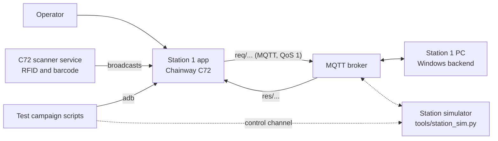

<div align="center">


<h1>PPNAM Station 1 handheld app</h1>

The Android app that goods-receiving operators at PPNAM Station 1 use on the Chainway C72 handheld.<br>
It assigns RFID tags to prepared pallets and records each pallet coming off the truck against its purchase order or stock transfer.<br>
Every scan and every sign-in is checked by the Station 1 PC over MQTT.

<br>


&nbsp;&nbsp;&nbsp;&nbsp;&nbsp;&nbsp;
<picture>
  <source media="(prefers-color-scheme: dark)" srcset="docs/assets/systems-one-dark.png">
  
</picture>

<br><br>

[Latest release (APK)](https://github.com/Systems-One/PPNAM_Station_1_AA/releases/latest) ·
[Operator SOP (PDF)](docs/sop/PPNAM_Station_1_Handheld_SOP.pdf) ·
[MQTT contract](docs/Station1_MQTT_Contract_v3.md) ·
[Test matrix](docs/TEST_MATRIX.md) ·
[All documentation](#documentation)

</div>

## Contents

- [What it does](#what-it-does)
- [What the system can do](#what-the-system-can-do)
- [How it fits together](#how-it-fits-together)
- [Status](#status)
- [Get started](#get-started)
- [Install on a handheld](#install-on-a-handheld)
- [Documentation](#documentation)
- [Repository layout](#repository-layout)

## What it does

Receiving operators sign in on the handheld and do two jobs. **Tag Assignment** gives each prepared pallet its RFID tag. **Offload** records each pallet coming off the truck against its purchase order or stock transfer, and closes the document when the delivery is done. The handheld decides nothing on its own: the Station 1 PC accepts or refuses each scan and the handheld shows the answer.

- Sends each scanned RFID tag to Station 1, which assigns it to the next prepared pallet.
- Checks that a pallet's RFID tag and barcode belong together, then shows the expected bag weight, bag count and batch reference. The operator can correct the weight and the bag count.
- Shows which document the pallet belongs to and how many of its pallets are in.
- Closes the document as Complete, or reports Too Little Tags or Too Many Tags with a count.

It does not prepare pallets, print labels or post to SAP; those happen on the Station 1 desktop. It keeps nothing to send later, so every scan needs Station 1 online.

## What the system can do

### Handheld app

Built and tested: 150 JVM unit tests pass, and the 50-case on-device campaign in the [test matrix](docs/TEST_MATRIX.md) passed against the simulator on a physical Chainway C72.

| Area | Capability |
|---|---|
| Sign-in | Username and password (SCRAM-SHA-256; the password itself is never sent), or an RFID badge scan on the Log In screen. |
| Username list | A dropdown of operators served by the station and cached on the handheld. A typed username still works. |
| Permissions | The station's sign-in answer lists which jobs the operator may do. Other tiles are dimmed; a missing list enables nothing. |
| Tag Assignment | Scan a tag, wait for the station's answer (10 second timeout), show accepted or the refusal reason. |
| Offload | Scan tag and barcode, review prefilled pallet values, confirm, then Next Pallet, Complete, Too Little Tags or Too Many Tags depending on the pallet count. |
| Session safety | Signs the operator out after inactivity (15 minutes by default, configurable, 0 = never), when Station 1 goes offline, or when the station ends the session. The reason is shown on Log In. |
| Connection status | A status pill on every screen: Connected, Reconnecting, Station 1 offline, Offline. |
| Scan feedback | A success chirp or fail buzz with vibration once the outcome is known; a repeat of a just-refused value within 1.5 seconds is silent. |
| Settings | Diagnostics for everyone (broker, station, version, device id). Broker settings and auto sign-out behind a supervisor PIN with a 30 second lockout after five wrong attempts. Test & Apply reconnects without signing the operator out. |
| Credentials | The broker password is stored encrypted with an Android Keystore key and is never shown again. |
| Device identity | Each handheld derives its own id (`scanner_` plus 12 hex characters) and shows it in Settings. |

### Test tools

Built and tested: 86 pytest cases pass for the simulator's logic.

| Area | Capability |
|---|---|
| Station simulator | `tools/station_sim.py` stands in for the Station 1 Windows backend over MQTT: presence, sign-in, both workflows, and a control channel to force errors, timeouts, station offline and session expiry. |
| Protocol check | `tools/test_campaign/fake_scanner.py` acts as a scanner against the running simulator and asserts every response. |
| On-device campaign | The `tools/test_campaign/*_section.py` scripts drive the app on a C72 over adb, inject scans as scanner broadcasts, and write results that `build_matrix.py` turns into the test matrix. |
| Scan injection | `tools/inject_scan.py` sends a barcode or RFID scan to a connected handheld over adb. |

### Delivery

Built and in use: the release workflow has published v1.0.0.

| Area | Capability |
|---|---|
| Release build | Pushing a `v*` tag builds the APK on GitHub Actions and publishes it as a GitHub Release named `PPNAM_Station_1_AA.apk`. |
| Signature check | The build fails unless the APK is signed with the shared PPNAM keystore, so updates install over the apps already on provisioned handhelds. |
| Operator SOP | `docs/sop/content.md` is built into a self-contained HTML file and an A4 PDF with the vendored SOP template. |

## How it fits together



The Station 1 Windows backend is a separate project and is not in this repository. The simulator takes its place for testing.

| Part | What it does | Folder |
|---|---|---|
| Handheld app | Five screens (Log In, home, Tag Assignment, Offload, Settings) in Kotlin with XML layouts. Talks MQTT through the HiveMQ client. | [`app/`](app/) |
| MQTT contract | The agreed messages between the handheld and the Station 1 backend: topics, presence, sign-in, both workflows, error codes. | [`docs/Station1_MQTT_Contract_v3.md`](docs/Station1_MQTT_Contract_v3.md) |
| Station simulator | Python stand-in for the backend. Business behaviour is in `simlib/`, covered by pytest. | [`tools/`](tools/) |
| Test campaign | adb-driven functional tests on a real handheld, plus the results and screenshots they produced. | [`tools/test_campaign/`](tools/test_campaign/) |
| Operator SOP | Source text, screenshots, the vendored template and the generated HTML and PDF. | [`docs/sop/`](docs/sop/) |
| Release workflow | Builds, verifies the signature and publishes the APK. | [`.github/workflows/`](.github/workflows/) |

## Status

| Part | State |
|---|---|
| Handheld app | Released. `app/build.gradle.kts` is at version 1.0.0, version code 12. The commit history shows 1.5.2, then 2.0.0, then a fleet-wide reset to 1.0.0; the version code kept rising so handhelds can still update. |
| JVM unit tests | 150 pass (`:app:testDebugUnitTest`, run 2026-11-27). They cover the pure logic: message building, policies, lockout, debounce. There are no screen-level automated tests; `app/src/androidTest` holds only the generated example. |
| Simulator tests | 86 pass (`pytest tools/tests`, run 2026-11-27). |
| On-device campaign | 50 of 50 passed, generated 2026-11-12, against the simulator. It has not been rerun in this repository since the version reset, and it does not exercise the real Windows backend. |
| MQTT contract | Version 3.3.0, last updated 2026-09-18. Section 10 of the contract lists backend work that was still pending when it was written (the operator list handler and the short/over tag counts). This repository cannot show whether the Windows backend has caught up. |
| Operator SOP | Written for app 1.5.2 (2026-11-12). Its version numbers and the Settings screenshot predate the reset to 1.0.0. |
| Release | v1.0.0 published 2026-11-26 by the release workflow. It is the only tag in the repository. |
| Legacy code | The root [`src/`](src/) folder is an earlier app (`com.sysone.scanner`, "SysOneScanner"). `settings.gradle.kts` includes only `:app`, so it is not built. The root `TAG_REASSIGN_INTEGRATION.md`, `convert_images.ps1`, `proguard-rules.pro` and `tools/mqtt_simulator.py` belong to that earlier app. |
| Simulator docstrings | `tools/station_sim.py` describes itself as contract v3.1.0 although it implements the 3.2.0 and 3.3.0 additions according to the contract. |

## Get started

You need Android Studio or a JDK (the CI build uses JDK 17) with the Android SDK for API 35, and Python 3 with `pytest` for the simulator tests. The simulator itself also needs `paho-mqtt`.

```powershell
# Build the debug APK (output: app\build\outputs\apk\debug\app-debug.apk)
.\gradlew.bat :app:assembleDebug

# Run the JVM unit tests
.\gradlew.bat :app:testDebugUnitTest

# Run the simulator's tests (offline, no broker needed)
python -m pytest tools/tests
```

> [!WARNING]
> `tools/station_sim.py`, `tools/mqtt_simulator.py` and everything in `tools/test_campaign/` connect to a real MQTT broker and announce themselves as Station 1. Their default is the shared broker `mqtt.sysone.co.za`. Do not run them on a broker the real Station 1 PC is using. Point them at a private broker with `--host`, `--port`, `--no-tls` and `--no-websocket`, or the `SIM_MQTT_*` environment variables described in `tools/test_campaign/simctl.py`.

> [!WARNING]
> The campaign scripts and `tools/inject_scan.py` drive whichever handheld is connected over adb: they relaunch the app, type into it and inject scans. Use a test handheld, not one in use at the station.

A local debug build is signed with your own debug keystore. It will not install over a released APK unless you have the shared PPNAM keystore; uninstall the released app first, or use a test device.

## Install on a handheld

1. Download `PPNAM_Station_1_AA.apk` from the [latest release](https://github.com/Systems-One/PPNAM_Station_1_AA/releases/latest).
2. Install it on the Chainway C72, for example with `adb install -r PPNAM_Station_1_AA.apk`. It updates an earlier released version in place.
3. Open the app. On a new handheld the status pill shows **Offline** because no broker password is saved yet.
4. A supervisor opens Settings (the gear), unlocks it with the supervisor PIN, enters the broker host, port, username and password, and taps **Test & Apply**. Wait for *Connected — settings saved*.
5. Read the **Device ID** from Settings if the station needs it for enrolment.
6. Sign in with a Station 1 username and password, or scan a badge.

The full operator and supervisor procedure is in the [SOP](docs/sop/PPNAM_Station_1_Handheld_SOP.pdf).

To publish a new release, raise `versionCode` and `versionName` in `app/build.gradle.kts`, then push a `v*` tag. The workflow needs the `DEBUG_KEYSTORE_B64` repository secret.

## Documentation

| I want to | Read |
|---|---|
| Use the app as an operator or supervisor | [SOP (PDF)](docs/sop/PPNAM_Station_1_Handheld_SOP.pdf) or [SOP (HTML)](docs/sop/PPNAM_Station_1_Handheld_SOP.html) |
| Edit the SOP text | [`docs/sop/content.md`](docs/sop/content.md) |
| Rebuild the SOP, or understand its template | [`docs/sop/_template/README.md`](docs/sop/_template/README.md) |
| Know exactly what the handheld and the station send each other | [MQTT contract v3](docs/Station1_MQTT_Contract_v3.md) |
| See what has been tested on a real handheld | [Test matrix](docs/TEST_MATRIX.md) |
| See the Offload flow as a diagram | [Station 1 Flow.png](Station%201%20Flow.png), source [Station_1.drawio](Station_1.drawio) |
| Understand how the simulator and test campaign were designed | [Simulator and test campaign design](docs/superpowers/specs/2026-08-25-station-sim-test-campaign-design.md) |
| Understand the session and scan behaviour decisions (app 1.3.0) | [Session and scan UX design](docs/superpowers/specs/2026-09-17-session-and-scan-ux-design.md) |
| Follow how contract 3.0.0 was implemented | [Contract 3.0.0 plan](docs/superpowers/plans/2026-08-25-mqtt-contract-3.0.0.md) |
| Follow how the session and scan changes were implemented | [Session and scan UX plan](docs/superpowers/plans/2026-09-17-session-and-scan-ux.md) |
| Follow how the UI audit findings were fixed | [UI audit fixes plan](docs/superpowers/plans/2026-10-02-ui-audit-fixes.md) |
| See what replaced the old login contract | [`LOGIN_MQTT_CONTRACT.md`](LOGIN_MQTT_CONTRACT.md) (superseded; summarises the changes from 3.0.0 to 3.3.0) |
| Read the Tag Reassign protocol of the earlier app | [`TAG_REASSIGN_INTEGRATION.md`](TAG_REASSIGN_INTEGRATION.md) (legacy; a copy is in [`app/`](app/TAG_REASSIGN_INTEGRATION.md)) |
| See how releases are built | [`.github/workflows/release.yml`](.github/workflows/release.yml) |

## Repository layout

| Folder or file | What is in it |
|---|---|
| [`app/`](app/) | The handheld app: Kotlin sources, layouts, resources, and the JVM unit tests under `app/src/test`. |
| [`docs/`](docs/) | The MQTT contract, the test matrix, the SOP (`docs/sop/`), design specs and implementation plans (`docs/superpowers/`), and the README images (`docs/assets/`). |
| [`tools/`](tools/) | The station simulator, its library (`simlib/`) and tests (`tests/`), the on-device test campaign (`test_campaign/`), and the scan injector. |
| [`screenshots/`](screenshots/) | `capture_sop.py`, which captures SOP screenshots from a connected handheld, and an earlier set of captures in `sop_images/`. |
| [`.github/`](.github/) | The release workflow. |
| [`gradle/`](gradle/) | The Gradle wrapper and the dependency version catalogue (`libs.versions.toml`). |
| [`src/`](src/) | The earlier SysOneScanner app. Not part of the build. |
| [`Logo/`](Logo/) | A logo image file from the earlier app. |
| `.idea/`, `.vscode/` | Shared IDE settings. |
| `build.gradle.kts`, `settings.gradle.kts`, `gradle.properties`, `gradlew`, `gradlew.bat` | The Gradle build. |
